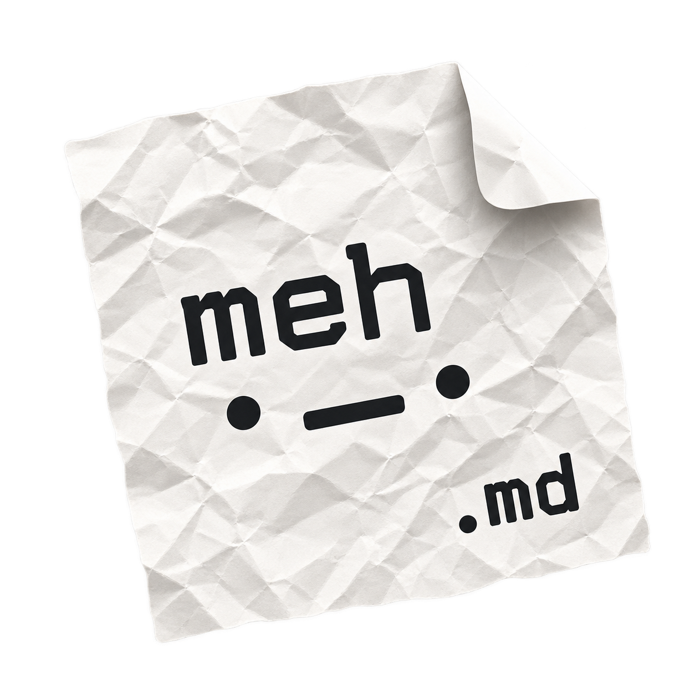
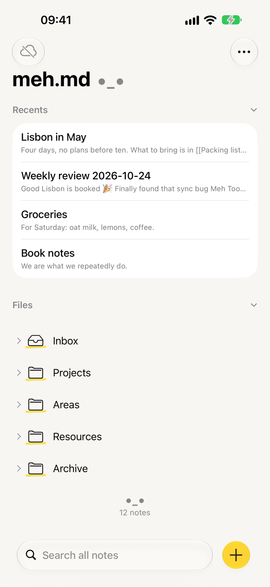
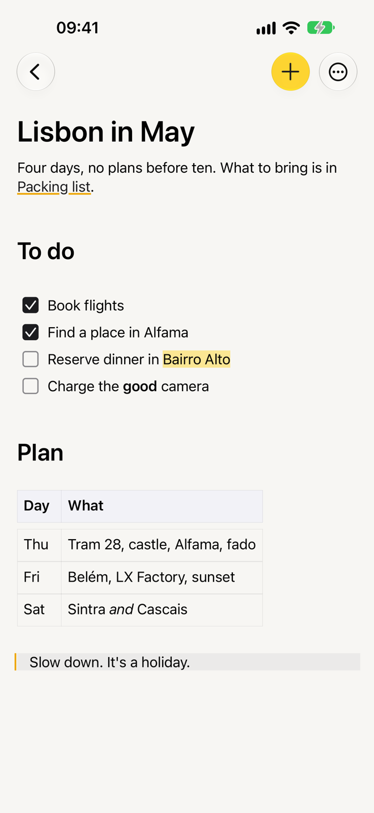
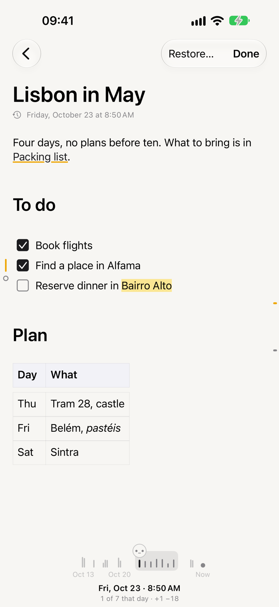
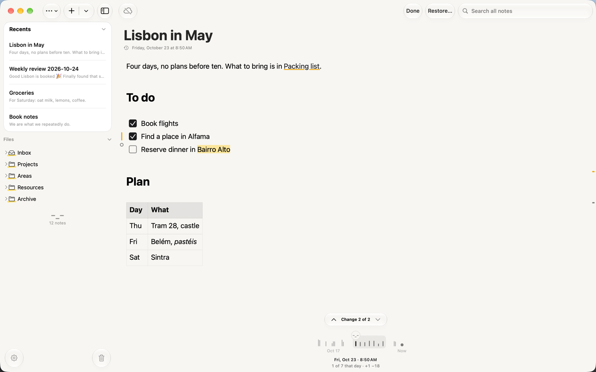

# meh.md - Minimalistic Markdown note taking app with a great sync

meh.md is my attempt to finally build the note taking app of my dreams:
Markdown-first, without the whole ‘everything is a block’ thing (I look at
you, Notion and Craft), simple, minimalistic UI, AND: having a great sync
out-of-the-box ⚡️.

## So how does the app look like?

A picture says more than a thousand words(?), so here are a few screenshots:

  
  
  

### Features

The goal of the app wasn't to rebuild Obsidian, but condense some of its
useful features. It should feel native, be fast, and just fun to use.

It has..

* Most of the Markdown features that I use day to day (if you are missing one,
  feel free to create an issue)
* Great iCloud sync 🤓
* Templates and snippets 💪
* (Back)links
* Version history (which gives me peace of mind when rewriting notes 🙏)
* Works for iPhone, iPad, and Mac
* ..and: no need for yet another account or subscription 🙌

As I said: The app was mainly built for me. If it works for you - that's
awesome! If you have an idea for another feature: Cool! Feel free to open
an issue, but please don't expect it to actually happen.

## How does sync work?

What I personally find REALLY COOL is the way data is synced: Many apps
either "trust" iCloud files for it (which I found horrible with Obsidian,
especially when editing the same note on multiple devices), or they require
you to sign up for their service (including paying a monthly subscription).
Meh.md goes a slightly different way: Yes, it uses iCloud for storage, but with
[CRDT](https://crdt.tech) under the hood (thanks to the AWESOME
[Automerge](https://automerge.org)
library). What does that mean for you? Local-first syncing without the risk of
conflicts. You can feel safe to edit the same note across multiple devices
with the confidence that everything will be fine. That's pretty cool 😎

## Where can I get it?

The app is still a work-in-progress, and I'm HEAVILY using AI for it. But
I already trust it as my only note taking app - across iPhone, Mac, and iPad.
For now it is available via TestFlight,
while I iron out things and make the experience nice.
If you are curious, feel free to
[join that group](https://testflight.apple.com/join/NRAvtpSJ). But keep
in mind: Use it at your own risk 🤞

For the long run I plan to make it available on the App Store, and I want
to keep it free (I'm sick of yet another forced subscription service). If
you'd like to support it anyway, see
[Can I support meh.md?](#can-i-support-mehmd)

## Build it yourself

The project currently targets macOS 27, iOS 27, and iPadOS 27 and needs Xcode
with the corresponding SDKs.

1. Open `meh.md.xcodeproj`.
2. Choose `meh.md Local` for local notes, `meh.md iCloud Dev` for development
   iCloud sync, or `meh.md` to exercise the production Release configuration.
3. Select your Mac, simulator, or connected device and run the app.

For signing, iCloud setup, and the separate development app identities, see
[development builds](docs/development-builds.md) and
[CloudKit setup](docs/cloudkit-sync-setup.md).

## Documentation

Be aware: Those docs are 100% AI-written. Some of them I will probably
refine eventually, but that wasn't my priority so far.

- [Product brief](docs/product.md): goals, scope, and what success looks like.
- [Roadmap](docs/plan.md): milestones and remaining acceptance work.
- [Architecture](docs/architecture.md): how the app fits together.
- [Documentation index](docs/README.md): development guides, contracts,
  decisions, and historical verification records.
- [Writing experience plan](docs/milestone-4-plan.md): milestone-four scope,
  issues, privacy boundary, and editor validation.

## Can I support meh.md?

meh.md is free, and I don't plan to make money with it. It's the note
app I wanted for myself, and I'm happy if it's useful to you too 😊

Two costs come out of my own pocket: the yearly Apple Developer fee
that's needed to publish on the App Store, and my Claude subscription,
which does a lot of the work of maintaining the app. If you'd like to
help with those, you can do so via
[PayPal](https://paypal.me/AndreasSkor). But don't worry. I'm just
happy if the app is useful for you as well.
